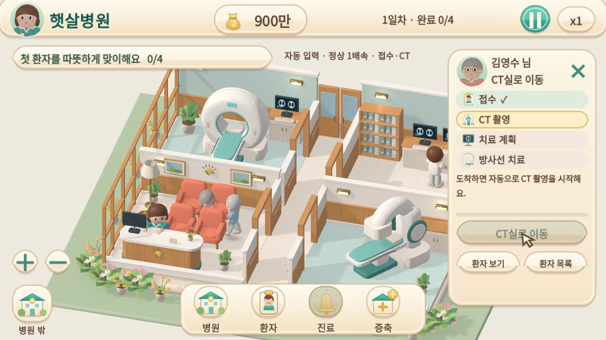

# 햇살병원 방사선과

Godot **4.6.3**로 제작 중인 Mac/iPhone 가로 화면 중심의 3D 병원 운영 게임입니다.
가로 화면으로 여러 3D 진료실을 살피며 환자를 접수하고, 계획 검토를 맡기고, 치료별관을 증축합니다.

## 실행

Godot 4.6.3에서 [`godot/project.godot`](godot/project.godot)을 가져온 뒤 **F6이 아닌 F5(프로젝트 실행)** 를 누르세요.
CLI가 준비된 Linux 환경에서는 다음을 실행합니다.

```sh
./tools/setup.sh
./tools/start-game.sh
```

- 아이폰에서는 가로로 돌려 플레이합니다. 세로 접속에는 전환 안내가 나타납니다.
- 빈 공간을 드래그해 병원을 둘러봅니다. 왼쪽 아래 **＋ / −**로 확대·축소하고 하단 가운데 **병원**으로 전체 배치를 봅니다. 마우스 휠도 지원합니다.
- 환자 캐릭터를 누르거나 하단 가운데 **환자** 아이콘으로 목록을 엽니다. 화면 안에 있는 환자를 선택해도 시점은 유지합니다.
- 환자를 선택하면 오른쪽에 초상화·진료 단계·행동 버튼이 나타납니다. **×**로 패널을 닫습니다.
- **진료** 아이콘은 접수·계획 지시가 필요한 환자로 선택을 옮깁니다. 상태 갱신이 선택을 바꾸지 않습니다.
- CT·계획·치료 대기열에는 차례와 기다리는 이유, 추가 지시 없이 자동 진행되는지를 표시합니다.
- 진료 단계가 바뀌어도 기본 시점과 확대율은 유지합니다. 화면 밖 선택 환자만 최소한으로 찾아갑니다. 상세 확대는 카드의 **환자 보기**, 기본 운영 시점 복귀는 **병원**을 누릅니다. 드래그·줌은 상태 갱신보다 우선합니다.
- 첫 치료 후 600만으로 별관을 증축하면 실제 두 번째 치료 장비가 생깁니다.
- 네 환자가 모두 귀가하면 다음 날을 시작합니다.
- 자동 저장을 불러오면 일시정지 상태입니다. **재생**으로 이어갑니다. 상단 **x1 / x2**로 진행 속도를 바꿉니다.

## 영상과 직접 체험

[최신 캐릭터 동작 영상 3개](docs/character-motion.html) · [동작 변경과 한계](docs/character-motion.md) · [이전 카메라 전후 비교](docs/stable-camera.html) · [이전 구도·상태 안내 검토](docs/play-feedback.html) · [체험 빌드와 게시 상태](docs/play-review.md) · [남은 작업과 다음 순서](docs/roadmap.md)

Mac/iPhone을 위한 웹 빌드를 준비했습니다. 공개 플레이 링크는 Pages 게시 후 실제 접속을 확인해야 합니다.



## 현재 상태

이전 클라우드의 게임 코드는 확보하지 못했습니다. 이 저장소의 게임은 사용자 인계서와 원본 기획서를 바탕으로 **재구현**한 프로토타입입니다. 이전 코드의 복구본이 아닙니다.

현재 기능: 별도 Blender/GLB 모델을 사용한 가로 3D 병원 내부, 병원 외관, 환자·직원 모델, 대기 좌석·책 읽기·호흡·깜박임, 거리 기반 보행·부드러운 회전·검사/치료 자세 전환·민지 응대, 4명 진료, FIFO 장비 예약, 치료별관, 다음 날, 로컬 저장, 환자 목록·조작 필요 표시·대기 순서.

초기 자금 900만, 환자당 200만, 증축 600만은 운영 검증용 임시 밸런스입니다. 환자·성과는 게임 내 가상 설정입니다.

[아트 방향과 현재 차이](docs/art-direction.md) · [전체 화면 게임 UI](docs/images/fullscreen-game.png) · [환자 목록](docs/images/patient-list.png) · [검증 기록](docs/validation.md) · [성장 세계관](docs/world-progression.md)

## 검증

```sh
./tools/test-godot.sh
python3 tools/run-visual-qa.py
```

두 번째 명령은 Linux의 Xorg dummy 드라이버, Mesa OpenGL, xdpyinfo가 필요합니다. Xorg는 로컬 전용 `:98`을 사용하며 TCP를 열지 않습니다. 실행 중인 동일 번호의 X 서버가 있다면 먼저 사용 여부를 확인해야 합니다. QA는 플레이어 저장을 사용하지 않습니다.

Android APK / iOS IPA, 실기기 테스트, 최종 모델·표정, 스토리·퍼즐, 직원 자동 운영, 지역 지도·연구소·세계 네트워크는 아직 없습니다. 원래 프로젝트의 저장 파일은 호환을 검증하지 못했으므로 자동 이전하지 않습니다.

## 자료와 작업 원칙

- [현재 제작 기준과 기획 메모](docs/design-baseline.md) · [사용자가 제공한 첫 시즌·수익화 원문](reference/README.md)
- `godot/`: 본게임 소스, 게임용 3D 모델·텍스처, 테스트, 한글 글꼴 및 라이선스.
- `art/`: 패킹된 Blender 원본과 제작 안내. `tools/art/`에서 모델을 재생성할 수 있다.
- `reference/`: 사용자 인계서와 원본 기획서·기획용 HTML. HTML은 제품 화면의 템플릿이 아닙니다.
- `docs/`: 현재 구현, 검증과 후속 계획.
- `.runtime/`, `artifacts/`, `godot/.godot/`: 로컬 데이터·생성 결과물. Git 제외.
- [AGENTS.md](AGENTS.md): 검증 후 커밋·main 푸시 등 지속 지침.

커밋된 소스와 선택한 화면 캡처는 Git 원격에 보관합니다. 로컬 저장 파일·전체 QA 결과물·ZIP은 자동으로 원격에 포함되지 않습니다.
