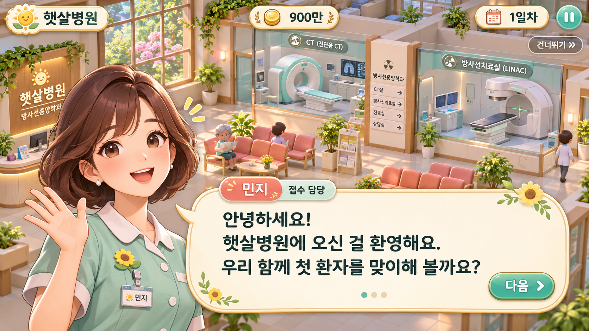

# 민지 대화 연출 — 승인된 시안의 구현 기준

2026-11-20 KST 사용자 요청: 대화에서 생성한 민지 대화 시안을 Git에 보관하고, 해당 방향으로 Unity 후속 구현을 진행한다. 이 문서는 구현 지침이며 기능 구현·실행 검증 완료 보고가 아니다.

## 시안 원본 보관 상태

- 사용자 Mac의 Downloads에서 원본 PNG를 확인해 `reference/art/minji-dialogue-concept.png`에 보관했다.
- 이미지의 병원 배치, CT 설명, 간판 텍스트, 장비 배치는 제품·의료 설계의 근거가 아니다. 참조 대상은 캐릭터 초상과 대화 UI의 미술 및 구성이다.

## 확정된 시각적 방향

가로형 실제 3D 병원 위에 **큰 민지 초상과 말풍선형 대화창**을 겹쳐 표시한다. 기존에 이름과 대사만 나오는 넓은 흰색 띠를 이 연출로 교체한다. 완성 시안 한 장을 게임 화면에 덮어 붙이는 방식은 사용하지 않는다.

- 민지: 갈색 단발, 따뜻한 갈색 눈, 흰 칼라의 민트 근무복, 해바라기 배지, 친근한 성인 인물. 게임 속 작은 3D 민지와 헤어·옷·색상을 일치시킨다.
- 초상은 원형 아바타가 아닌 투명 배경의 허리 또는 가슴 위 일러스트다. 왼쪽 전경에 크게 나타나고 패널 가장자리와 살짝 겹친다.
- 시안 기준 초상은 화면 너비 약 30~38%, 높이 약 65~80%를 차지한다. 고정 픽셀 규칙이 아니라 출발 비율이며 좁은 가로 화면에서는 조정한다. 얼굴·손·이름·대사가 잘리지 않아야 한다.
- 대화창은 오른쪽 하단 중심의 둥근 크림색 말풍선이다. 얇은 샴페인 골드 테두리, 부드러운 그림자, 작은 해바라기 장식을 사용한다.
- 이름은 코랄색 `민지` 배지, 역할은 작은 `접수 담당` 표시로 구분한다.
- 본문은 짙은 청록색의 둥글고 읽기 쉬운 한글이다. 가는 회색 글자나 과도한 외곽선을 사용하지 않는다.
- 다음 버튼은 입체감이 약하게 있는 민트색 버튼과 화살표다. 건너뛰기는 덜 강조하되 찾을 수 있어야 한다.
- 뒤쪽 병원은 실제 3D 장면을 유지한다. 필요하면 얇은 반투명 덮개로 대화에 집중시키되 배경이 무엇인지 보이게 한다.
- 상단 HUD는 작은 병원 배지·자금 캡슐·날짜·일시정지 구성과 어울리게 한다. 새 수치나 기능을 이미지 때문에 추가하지 않는다.

## 자산 분리와 품질

1. 투명 PNG 초상: 기본 미소, 인사, 설명, 기쁨, 걱정의 다섯 표정을 목표로 한다. 인물의 얼굴·헤어·옷·비율은 유지한다. 처음에는 검증된 인사 초상부터 실제 연결하고 추가 표정을 확장한다.
2. 프레임·이름 배지·버튼·장식은 분리하고 크기 변경에 견디는 9-slice 또는 기존 UI 시스템의 동등한 방식으로 구현한다.
3. 글자와 버튼은 실제 UI다. 이미지에 대사나 버튼 글자를 구워 넣지 않는다.
4. 초상 분리·생성이 가능한 도구가 있으면 참조 시안 기반으로 작업한다. 없으면 빈 그림, 이모지, 기존 3D 캐릭터의 거친 확대를 최종 초상으로 대신하지 말고 실제로 준비된 범위와 남은 원본 제작을 기록한다.
5. 폰트는 공식 출처에서 상업용 게임 임베딩 라이선스를 확인한다. 주아체·쿠키런체·나눔스퀘어라운드는 후보이지 자동 승인된 라이선스 결론이 아니다.

## 동작과 기존 게임의 통합

- 큰 초상 대화는 환영, 중요한 챕터 대사, 증축·연구·지역 성장 사건에 사용한다. 매번 발생하는 운영 상태 안내는 작은 말풍선이나 환자 카드로 유지한다.
- 등장·퇴장은 짧은 페이드/슬라이드로 구현하고 모션 감소 설정이 있다면 따른다. 텍스트 가독성을 해치는 상시 흔들림은 피한다.
- 타자 효과가 있다면 첫 입력은 문장 전체 표시, 다음 입력은 다음 대사로 진행한다. 연타로 여러 대사가 동시에 넘어가지 않게 한다.
- 말하는 인물과 표정을 대사 데이터로 지정한다. 대화 코드에 모든 스토리를 하드코딩하지 않는다.
- 중요한 대화 중 운영 시간은 정지한다. 닫을 때는 열기 전 사용자 일시정지 상태를 보존한다. 다른 모달·백그라운드 정지 상태를 무시해 강제 재생하지 않는다.
- 대화 입력이 뒤의 환자나 장비 선택으로 통과하지 않게 한다.
- 건너뛰기는 대사 표시만 처리한다. 치료·보상·챕터 달성·시설 구매를 임의 완료하지 않는다.
- 대화 진행 ID·줄 위치·완료 상태를 기존 저장 정책에 맞춰 보관한다. 기존 저장을 초기화하거나 이미 완료한 대화를 강제 재생하지 않는다.
- 다시 보기에서 보상이나 튜토리얼 이벤트가 재지급되지 않게 한다.
- 실제 병원 모델·운영 상태·경제·대기열은 보존한다. 이 작업을 위해 카메라를 다른 방으로 계속 이동시키지 않는다.

첫 환영 대사의 표현 예시(기존 시나리오와 길이를 조정할 수 있음):

> 안녕하세요! 햇살병원에 오신 걸 환영해요.
> 우리 함께 첫 환자를 맞이해 볼까요?

## 검증과 전달

- Unity 에디터 실제 컴파일과 Play를 확인한다. 독립 C# 검사 통과만으로 완료라고 쓰지 않는다.
- 16:9 및 긴 가로 화면에서 얼굴·손·본문·버튼 안전 영역과 줄바꿈을 확인한다.
- 인사→다음→닫기→접수, 건너뛰기, 대화 도중 저장·복원, 기존 일시정지 상태 복귀를 확인한다.
- 최신 빌드에서 한글 누락, 초상 투명도, 텍스처 가장자리, 버튼 입력, 대화 종료 후 남는 패널을 점검한다.
- `docs/media/`에는 저장소 정책에 맞는 검토용 PNG와 적정 크기의 정상 속도 MP4를 제공한다. 원본 대용량 영상과 캐시는 포함하지 않는다.
- 시안과 실제 구현을 같은 가로 비율로 비교한다. 실제 게임 장면을 시안으로 위장하지 않는다.
- `docs/ui-review.md`에 참조 자료, 변경 사항, 직접 확인/자동 시연/사용자 확인/미검증, 자료 경로, 기준 커밋을 기록한다.

## Mac 구현 채팅에서 안전하게 가져오기

이 지침은 클라우드 채팅에서 원격 `main`에 문서만 추가한다. Mac에는 아직 푸시되지 않은 기능 커밋이 있을 수 있다. 먼저 Git 상태와 양쪽 로그를 확인하고 변경을 보존한 뒤 문서를 통합한다. 무조건 reset, clean, force push하거나 미커밋 작업을 덮어쓰지 않는다. 현재 작업은 안전한 구간에서 마무리하고 이 후속 UI 작업으로 이어간다.
