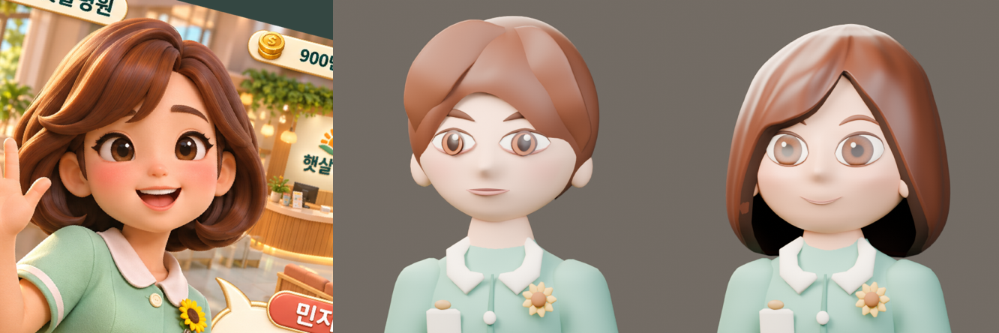

# 민지 v3 얼굴 검토

작업 기준은 `94b6ea7`이다. [대화 시안](../reference/art/3d-direction-v1/03-minji-dialogue.png)을 주 기준으로, [캐릭터 시안](../reference/art/3d-direction-v1/01-minji-character.png)을 보조 기준으로 Blender에서 얼굴과 단발을 조정했다. 이 버전은 검토용 작은 미소 한 가지를 담는다. 운영 캐릭터와 기본 대화는 기존 v2 자산을 계속 사용한다.

## 비교 자료

왼쪽부터 승인 시안, v2, v3 순서다. 시안은 얼굴을 확대하고 눈 높이를 맞추기 위해 기울기를 약 14도 보정했다. v2와 v3는 동일한 정사영 카메라와 조명에서 12도로 렌더했다. 시안에는 원근과 표정 차이가 남아 있으므로 절대 치수는 Blender 두 렌더를 기준으로 비교한다.

- [회색 형태 수정 과정](images/minji-face-study/grey-iteration.png) — 왼쪽 두 컷은 첫 초안의 정면·45도, 오른쪽 두 컷은 수정 후 정면·45도다. 첫 초안에서 따로 튀어나온 앞머리와 옆머리를 단일 곡면으로 다시 만들었다. 두 차수의 카메라 여백은 다르다.
- [Blender 정면·45도·측면](images/minji-face-study/blender-angles.png) — 같은 정사영 배율에서 눈과 턱의 깊이를 확인할 수 있다.
- [회색 머리 전체 실루엣](images/minji-face-study/grey-silhouette.png) — 정면·45도·측면·후면이다.
- [동일한 Unity 환영 대사 v2·v3](images/minji-face-study/unity-dialogue.png) — 왼쪽이 v2, 오른쪽이 v3다. 원본 캡처는 둘 다 로컬 `artifacts/minji-face-study/`의 2560×1440 PNG다.

## 모델에서 바뀐 부분

- **눈** — 뾰족하고 긴 v2의 눈 외곽을 세로로 더 높은 눈꺼풀 곡선으로 바꿨다. 홍채를 크게 잡고 동공과 반사점은 같은 방향으로 정렬했다. 첫 회색 렌더를 보고 눈의 전방 깊이와 홍채 표면의 단차를 줄였다.
- **볼과 턱** — 얼굴 메시를 새로 만들었다. 볼의 폭과 앞으로 나오는 정도를 키운 뒤 턱 끝으로 갈수록 폭을 줄였다. 코끝은 얼굴 표면 자체에서 솟게 했고, 기존 몸통의 목 부분만 분리해 턱 아래에 짧은 목을 맞췄다.
- **미소** — 입꼬리가 조금 올라가는 닫힌 입이다. 입술 아래의 볼륨을 얕게 만들고 어두운 이음선을 줄였다.
- **단발** — 가르마에서 이마를 비스듬히 지나가는 앞머리를 옆머리와 한 표면에 연결했다. 볼 양옆에 폭을 더하고 턱 아래로 내려온 끝을 안쪽으로 돌렸다. Unity 첫 비교에서 단발 안쪽이 푸르게 보인 부분은 Blender에서 무광 갈색 안쪽 면을 추가하고 재촬영했다.

시안과 비교하면 v3의 눈은 더 정면을 바라보고 윗눈꺼풀의 비대칭과 홍채의 따뜻한 반사광이 옅다. 시안의 앞머리는 끝이 더 크게 바깥으로 휘어 옆머리로 이어지고, 단발 아래쪽에는 여러 갈래의 말림이 보인다. v3는 바깥 폭은 늘었지만 끝단이 한 덩어리로 더 고르게 이어진다. 귀는 시안보다 더 많이 가려진다. 시안의 열린 인사 미소와 달리 이번 검토에서는 닫힌 작은 미소를 사용했다.

## 제작 파일과 재현

- [편집 가능한 Blender 원본](../art/source/minji-v3-face-study.blend)
- [Unity 에디터 검토용 GLB](../unity/Assets/Editor/HospitalArt/minji-v3-face-study.glb)
- [별도 얼굴 제작 스크립트](../tools/art/build_minji_v3_face_study.py)

Blender 4.5.16 LTS 앱에서 회색 초안과 수정안을 렌더했고, 별도로 저장한 `.blend`를 다시 열어 GLB를 내보냈다. 저장한 파일을 추가 편집하려면 Blender에서 직접 열고 내보내기를 사용한다. 스크립트의 `final`은 이미 저장된 검토 원본이나 GLB를 덮어쓰지 않는다. v2 `.blend`와 게임용 v2 GLB에는 Git 차이가 없다.

Unity 6000.6.9f1, URP, Metal에서 `Hospital` 씬의 Game 뷰를 Play한 뒤 `Shift+F1`을 입력했다. 임시 첫날 상태에서 같은 대사와 같은 카메라로 두 이미지를 캡처했다. 최신 파일을 다시 임포트한 실행의 Console은 캡처 로그 1건, 경고 0건, 오류 0건이었다. 촬영 뒤 시작 화면으로 복귀했다. 이 단축키는 에디터에서만 동작한다. 독립 C# 컴파일과 병원 로직 272개 검사도 통과했다.

이번 검증은 대화 자동 캡처와 화면 복귀까지다. 실제 대화 버튼을 연속 조작하는 테스트, 새 플레이어 빌드, 모바일, 추가 표정과 아이콘은 검토 범위 밖이다. 사용자의 얼굴 검토는 아직 남아 있다.
