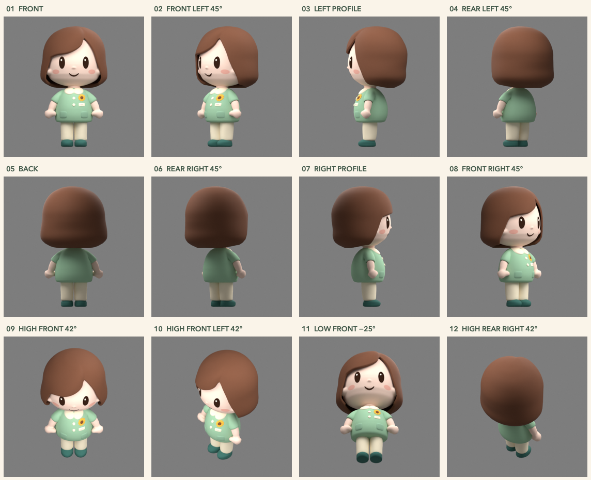

# 민지의 연결된 표면과 12각도 검토

수정 전 모델은 검토 브랜치 `3b76bac`이다. 생성 참고 이미지와 제작 지시는 `2d3dca23819c5a20a6d2ae58f9d23c3796e684d7`에서 가져왔다. 터미널의 GitHub DNS 조회는 실패했다. 문서 세 개는 GitHub 커넥터로 읽었고 PNG는 같은 커밋의 GitHub 원본 다운로드로 받았다. PNG를 직접 열고 Git 객체 SHA와 명세의 SHA-256 `f3ba164a71575e8deee71f98f9e76e09a078116dfdf2a1cc3cf151a7dcd5575d`가 일치하는지 확인했다. 네 파일만 추가했다. [생성 참고 PNG](../reference/art/minji-simple-12views/minji-12-view-sheet.png) · [제작 지시](minji-12-view-modeling-brief.md)

## 실제 Blender 모델 12각도

정면부터 지면과 평행하게 45도씩 여덟 방향을 렌더했다. 마지막 네 칸은 고도 +42도 정면, +42도 앞왼쪽, −25도 정면, +42도 뒤오른쪽이다. 같은 모델·기본 미소·팔 내린 자세·정사영 배율 2.37·흰 스튜디오 조명을 썼다. 참고의 시점과 소품 위치는 그림마다 조금씩 다르다. 실제 12칸에서는 배지의 신체 기준 왼쪽 위치, 머리 가르마, 몸통 앞뒤 깊이를 고정했다. 참고보다 뒷머리 밑선이 고르고 입체 귀는 덜 돌출된다.

## 연결부와 장식 전후

- [아래에서 본 어깨와 인사 중 손목·엄지 전후](images/minji-simple-connected/shoulder-and-wrist.png)
- [볼터치·코와 꽃 배지·명찰 전후](images/minji-simple-connected/face-and-badge.png)
- [Blender 편집 모드의 상의·팔 표면](images/minji-simple-connected/mesh-in-edit-mode.png) · [팔 들기 45도·90도 전후](images/minji-simple-connected/blender-lift.png)

상의의 두 옆면을 열고 가슴·등·겨드랑이의 둘레 정점을 소매 링에 연결했다. 소매 끝은 안으로 돌아간 옷단을 갖고 피부와 만난다. 팔마다 팔꿈치부터 손끝까지 한 표면이며 엄지는 손바닥 단면을 국소적으로 키워 만들었다. Blender 메시 검사에서 상의, 양팔, 얼굴은 각각 연결 성분 하나이며 세 면 이상이 공유하는 모서리가 없다. 상의에서 열린 모서리는 소매 끝 둘레 두 곳이다. 스킨 정점마다 본 가중치 합은 1이다.

뺨에는 높이와 그림자가 없는 384×384 sRGB 텍스처를 넣었다. 무늬가 없는 텍스처 부분과 손의 기본색은 모두 `#F5D5C5`다. 코와 작은 귀는 머리 메시 표면에서 완만히 돌출된다. 눈·입 그래픽은 유지했다. 해바라기는 가슴 곡면을 따라 납작한 물방울 꽃잎 열 장과 가장자리가 둥근 중심판으로 만들었다. 중심판 돌출은 꽃 지름의 약 11%다. 명찰을 얕게 만들고 꽃 아래의 돌기와 겹침을 없앴다.

## Unity Play 확인

- [정면·정확한 측면·후면·아래에서 본 어깨](images/minji-simple-connected/unity-views.png) · [아래에서 본 팔 0도·45도·90도](images/minji-simple-connected/unity-lifts.png)
- [실제 대화 화면](images/minji-simple-connected/dialogue.png) · [기본 카메라의 실제 운영 화면](images/minji-simple-connected/operations.png)
- [정상 속도 인사·보행 영상](media/minji-connected-greeting-walk.mp4) · [영상에서 추출한 여덟 자세](images/minji-simple-connected/motion-frames.png)

Blender 4.5.16 LTS에서 Cavity·Outline을 끄고 편집 모드를 촬영한 뒤 저장한 `.blend`를 다시 열었다. Unity 6000.6.9f1 URP Metal에서 `Hospital` 씬을 실제 Play하고 Game 뷰에 포커스를 둔 채 `Control+Option+F1`로 검토 모델을 실행했다. 대화 인사는 GLB의 기존 타이밍을 옮긴 본 클립을 샘플링한다. 운영 보행은 별도 인스턴스의 본을 기존 보행 주기에 맞춰 구동한다. 프리팹에서 자동 재생을 껐으므로 두 방식이 같은 본에 동시에 적용되지 않는다. 최초 임포트의 Mecanim 모드와 검토 샘플러의 불일치는 Legacy 클립으로 다시 가져와 해결했다. 최종 일반·에디터용 C# 컴파일을 별도로 확인했다.

영상은 960×540, 9.785초이며 정상 속도 자동 시연이다. 두 번 손을 흔들고 내려놓은 뒤 약 4.6초에서 대화 화면이 접수대로 전환된다. 원본 MP4를 디코딩해 시작·두 손짓·팔 내림·보행 왕복 네 지점을 확인했다. 검수 시점에서 어깨가 벌어지거나 손목이 분리된 모습은 보이지 않았다. 팔을 90도 들어 올리면 겨드랑이의 압축 주름은 남고, 인사에서 팔을 내릴 때 손끝이 말풍선 테두리에 가까워진다. 실제 접수대에서 얼굴은 대화 화면보다 어둡고, 해바라기의 꽃잎은 운영 기본 거리에서 하나씩 구분하기 어렵다. 모바일 실기기와 배포 적용은 미검증이다.

이 프리팹은 에디터 검토용이다. 일반 플레이와 사용자 저장은 기존 경로를 사용한다. [편집 가능한 Blender 원본](../art/source/minji-simple-connected.blend) · [Unity용 GLB](../unity/Assets/Editor/HospitalArt/minji-simple-connected.glb) · [검토용 프리팹](../unity/Assets/Editor/HospitalArt/MinjiConnectedReview.prefab) · [제작 스크립트](../tools/art/build_minji_connected.py)
