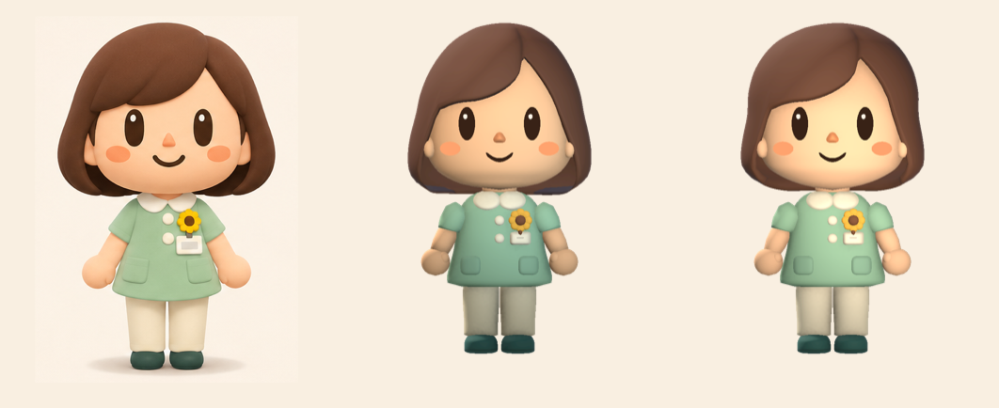

# 단순 3D 민지 마감 검토

후속 검토에서 앞뒤 부피와 피부를 조정했다. [새 입체 부피와 피부색 검토](minji-simple-volume-review.md)

기준 커밋은 `e30f6c6`이다. 가이드 원본은 GitHub main의 `237ca7a`에 있다. 새 마감은 기존 단일 모델과 검토 프리팹에 적용했다. 일반 플레이와 배포 빌드에는 적용 전이며 최종 사용자 승인도 대기 중이다. [캐릭터 시트](../reference/art/minji-simple-v1/minji-character-sheet.png) · [제작 지시](minji-simple-character-direction.md)

## 비교와 실제 캡처

왼쪽부터 시안, `e30f6c6`, 마감본이다. 정면과 45도 비교에서 Unity 전후 렌더는 같은 정사영 카메라, 높이, 배율로 맞췄다. 시안은 머리 높이를 약 184px로 정규화했다. 45도 비교의 시안은 왼쪽 인사 포즈를 사용했으며 생성 이미지의 회전각은 Unity와 차이가 있다.

- [시안·수정 전·수정 후 45도 비교](images/minji-simple-v1/angle-comparison.png)
- [Unity 정면·45도·후면](images/minji-simple-v1/angles.png) · [기본 미소·기쁨·설명](images/minji-simple-v1/expressions.png)
- [실제 Unity 대화 화면](images/minji-simple-v1/dialogue.png) · [실제 운영 화면](images/minji-simple-v1/operations.png)
- [12초 정상 속도 인사 영상](media/minji-simple-wave.mp4) · [원본 MP4에서 읽은 여덟 시점](images/minji-simple-v1/greeting-frames.png)
- [Blender 정면 전신과 45도 얼굴](images/minji-simple-v1/blender-model.png)

## 요청한 다섯 부분

1. 정수리 높이와 단발의 최대 폭을 유지했다. 위쪽 옆머리 반경을 넓혀 정면 삼각형 인상을 완화했고, 아래로 갈수록 폭을 줄여 끝이 안으로 돌아가게 했다.
2. 턱 중앙과 볼 사이에 단면을 추가해 아래 선을 둥글게 연결했다. 세로 타원 눈의 크기와 간격, 작은 코, 기본 미소와 설명 그래픽은 이전과 같은 형태다. [같은 회색 재질의 Blender 전후](images/minji-simple-v1/clay-comparison.png)
3. 기쁨은 기존의 감긴 눈에 입꼬리가 올라가는 적갈색 U자 입을 적용했다. 입 모양은 얼굴 곡면을 따르는 단색 메시다.
4. 어깨와 팔꿈치의 회전 범위를 조정해 장갑형 손을 볼 바깥으로 옮겼다. 팔꿈치 안쪽과 손목의 피부 메시가 더 깊게 겹치도록 늘려 회전할 때 연결이 드러나는 정도를 줄였다. 손목으로 두 번 짧게 흔들고 팔을 내린다.
5. 피부는 따뜻한 복숭아색, 바지는 더 밝은 크림색으로 조정했다. 초상 카메라의 보조광을 낮춰 손·바지와 턱 밑을 받치고, 주광과 전역 환경광·노출은 유지했다. 아래 비교는 마감 메시와 재질을 고정하고 보조광만 바꾼 Unity 캡처다. [이전·새 보조광 비교](images/minji-simple-v1/fill-comparison.png)

시안의 정면 얼굴은 볼이 더 넓고 앞머리 덩어리가 옆으로 더 길게 흐른다. 깊이와 조명을 분리해 확인한 결과 마감본의 단발 밑면에는 약한 접촉 그림자가 남는다.

## 실행 확인과 편집 파일

Blender 4.5.16 LTS에서 기준과 마감본의 회색 렌더를 비교하고 수정한 원본을 저장한 뒤 다시 열었다. Unity 6000.6.9f1 URP Metal에서 `Hospital` 씬을 Play하고 Game 뷰의 `Option+F1`으로 검토 프리팹을 대화와 접수대에 띄웠다. 대화 구도에서 검토 카메라를 넓혀 두 번 흔드는 구간의 손 실루엣을 확보했다. 팔을 내리는 순간 손끝은 말풍선 테두리에 가까워진다. Game 뷰 녹화는 임시 첫날 상태를 사용하는 정상 속도 자동 시연이다. 최종 파일은 12.023초, 960×540이다. 녹화 파일을 다시 디코딩해 시작, 두 번의 손짓의 안쪽·바깥쪽 극값, 팔을 내리는 순간, 내린 뒤, 기쁨을 확인했다.

[편집 가능한 Blender 원본](../art/source/minji-simple-v1.blend) · [제작 스크립트](../tools/art/build_minji_simple.py) · [Unity GLB](../unity/Assets/Editor/HospitalArt/minji-simple-v1.glb) · [Unity 프리팹](../unity/Assets/Editor/HospitalArt/MinjiSimpleReview.prefab)
