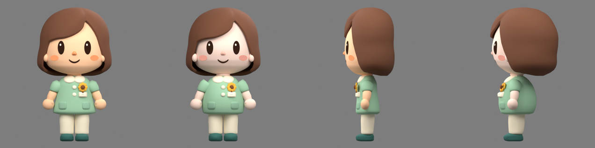
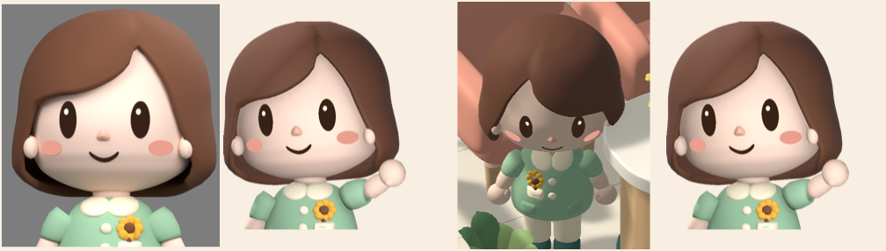

# 민지의 입체 부피와 피부색 검토

후속 작업에서 어깨와 손의 표면을 연결하고 새 12각도 참고를 반영했다. [연결 구조와 12각도 검토](minji-simple-connected-review.md)

이전 마감본 `ddd1a1a`를 기준으로 같은 단순 민지를 다듬었다. `Hospital` 씬의 Unity 에디터 Play 모드에서 Game 뷰에 포커스를 두고 `Option+Shift+F1`을 누르면 새 자산을 검토할 수 있다. 별도 첫날 상태에서 대화·운영 화면을 시연하고 이전 상태로 돌아온다. 일반 플레이와 배포 빌드는 기존 자산을 사용한다. [이전 마감본](minji-simple-review.md) · [기준 캐릭터 시트](../reference/art/minji-simple-v1/minji-character-sheet.png)

## 앞뒤 부피

왼쪽부터 수정 전 정면, 수정 후 정면, 수정 전 90도 측면, 수정 후 90도 측면이다. Blender에서 같은 흰색 스튜디오 조명, 정사영 카메라 높이와 배율을 사용했다. 머리와 상의도 각각 분리해 확인했다. 머리카락을 숨긴 머리는 이마·볼·턱과 뒤통수가 둥글게 연결된다. 위에서 본 상의는 가슴과 등이 모두 볼록한 타원형이다. [머리카락 없는 머리의 측면과 장식 없는 상의의 위쪽 전후](images/minji-simple-volume/uncovered-volumes.png)

| 메시 | 너비 전후 | 높이 전후 | 앞뒤 깊이 전후 |
| --- | ---: | ---: | ---: |
| 머리 | 0.924 → 0.924 | 0.985 → 0.985 | 0.699 → 0.937 |
| 상의 | 0.648 → 0.640 | 0.603 → 0.603 | 0.364 → 0.576 |

머리의 뒤쪽과 볼 높이에서 각각 단면을 깊게 잡고 턱 밑은 안쪽으로 돌렸다. 단발은 뒤통수와 옆 볼을 감싸고 목덜미에서 말린다. 타원 눈, 코랄 볼, 작은 미소를 새 얼굴 곡면에 다시 붙였다. 몸통이 두꺼워진 만큼 소매 위치를 맞췄다. 장갑 손, 팔·다리, 발등과 앞코의 깊이도 따로 조정했다. 칼라, 단추와 해바라기 배지는 각 형상을 유지한 채 새 상의 앞면에 붙였다. [Unity 정면·45도·정확한 측면·후면](images/minji-simple-volume/angles.png)

## 조명별 피부색

Blender의 흰색 스튜디오 조명에서 비교한 A `#F7DDCF`와 B `#F5D5C5` 중 B를 골랐다. A보다 밝은 분홍 기운을 남기면서 하이라이트가 덜 하얗게 뜬다. 이전 피부는 `#FFC89D`였다. glTF는 sRGB에서 선형으로 변환한 기본색을 저장한다. 얼굴과 양손은 같은 무광 피부 재질을 쓰며 피부색에 곱해지는 텍스처나 정점 색은 없다. [같은 흰 조명 아래 A·B 비교](images/minji-simple-volume/skin-candidates.png)

Unity의 프로젝트 색 공간은 Linear다. 중립 초상과 대화 초상은 같은 카메라와 자세로 비교했다. 초상은 병원 주광에서 분리하고 대화 키라이트의 노란 기를 줄였다. 접수대에서는 기존 조명 아래 얼굴이 중립 초상보다 어둡고 회색으로 가라앉는다. 보조광을 시험했을 때 얼굴만 안정적으로 밝히지 못해 병원 광원은 유지했다. 말풍선에 합성한 Game PNG와 선형 초상 RenderTexture를 각각 추출해 비교했다. [초상 RT와 Game PNG 비교](images/minji-simple-volume/portrait-composite.png)

## 실제 Unity 화면과 영상

- [대화 Game 뷰](images/minji-simple-volume/dialogue.png) · [기존 카메라의 운영 Game 뷰](images/minji-simple-volume/operations.png)
- [고정 카메라, 360도 회전 MP4](media/minji-volume-turntable.mp4) · [영상에서 읽은 정면·45도·측면·후면·반대쪽·종료 프레임](images/minji-simple-volume/turntable-frames.png)
- [인사와 접수대 보행 MP4](media/minji-volume-greeting-walk.mp4) · [영상에서 읽은 두 번의 손짓과 보행 프레임](images/minji-simple-volume/motion-frames.png)

두 MP4는 960×540이다. 360도 회전은 12.737초다. 카메라를 고정하고 캐릭터만 12초 동안 회전시켰다. 인사·보행은 9.735초다. 팔을 내린 뒤 약 4.6초 지점에서 대화에서 접수대로 화면이 전환된다. 이후 운영 기본 구도를 거쳐 보행을 가까이 보여준다. 두 영상 모두 배속을 사용하지 않았다. Blender에서 원본 영상을 디코딩해 회전 여섯 지점과 인사·보행 여덟 지점의 방향과 자세를 확인했다.

확인한 접수대 구간에서 팔과 다리가 몸통이나 가구를 크게 관통하거나 손목이 분리돼 보이는 장면은 없었다. 손을 내릴 때는 장갑 끝이 말풍선 가장자리에 가까워진다. 운영 영상은 접수대의 짧은 왕복 동선이다. 큰 고개 회전이나 병원 전체 동선은 이 영상에 포함되지 않는다.

## 제작 원본과 검증 범위

Blender 4.5.16 LTS에서 중립 조명의 여러 방향 렌더를 비교하고 저장한 모델을 다시 열었다. Unity 6000.6.9f1 URP Metal의 열린 에디터에서 `Hospital` 씬을 실제 Play하고 검토 단축키를 실행했다. 캡처를 비교한 뒤 화면 차이가 없었던 시험용 보조광 코드를 걷어 내고 설치된 Unity 어셈블리로 일반 및 에디터용 C#을 다시 검사했다. 두 영상은 사용자 저장과 분리된 첫날 상태의 정상 속도 자동 시연이다. 모바일 실기기와 배포 빌드 검증은 이번 검토에 포함되지 않는다.

[새 Blender 원본](../art/source/minji-simple-volume.blend) · [Unity GLB](../unity/Assets/Editor/HospitalArt/minji-simple-volume.glb) · [에디터 검토 프리팹](../unity/Assets/Editor/HospitalArt/MinjiVolumeReview.prefab) · [제작 스크립트](../tools/art/build_minji_simple.py)
