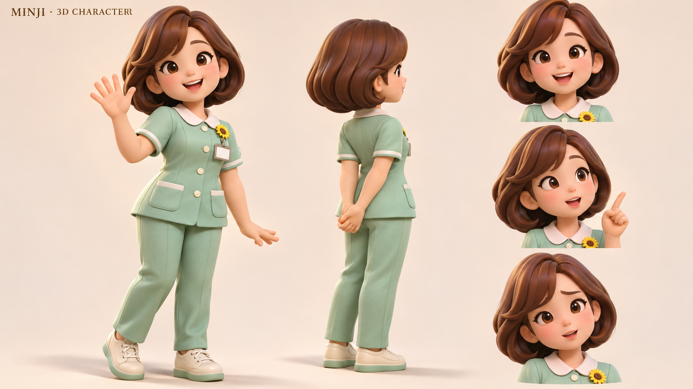
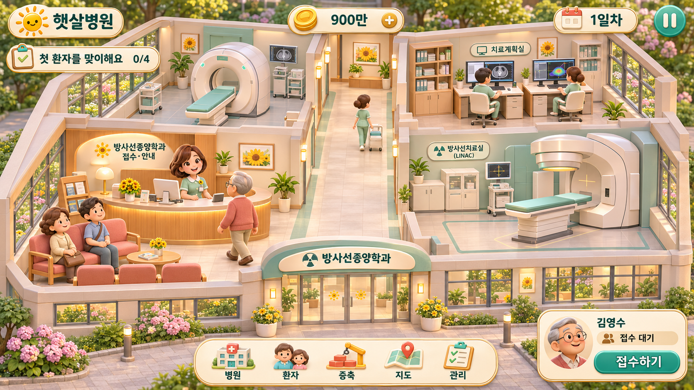
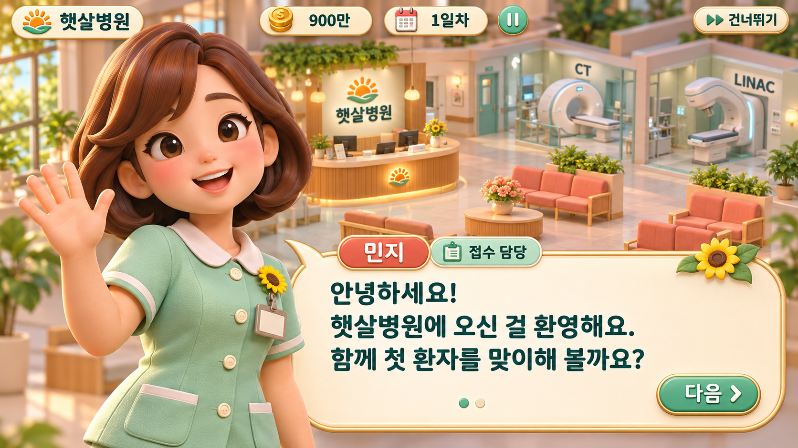
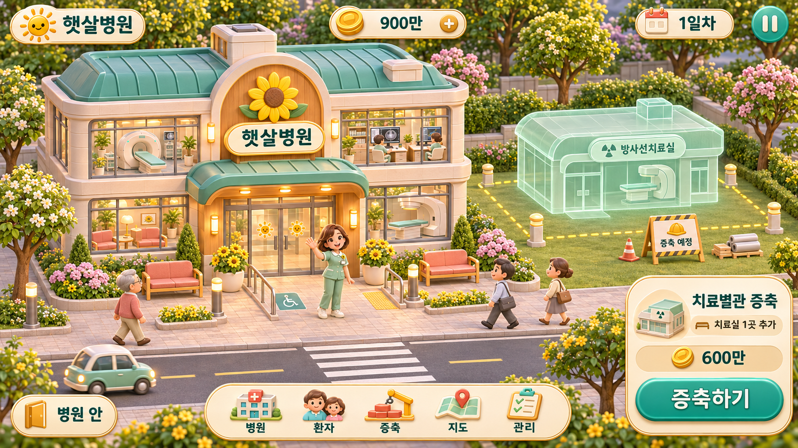
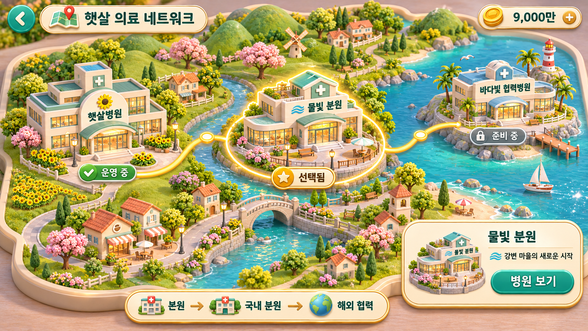

# 햇살병원 3D 캐릭터·화면 시안 v1

2026-11-20 KST 사용자 요청: 캐릭터를 더 디테일하고 귀엽게 만들고, 2D 일러스트 대신 3D 렌더 느낌으로 필요한 화면을 생성해 Git에 보관한다.

**아래는 생성형 이미지 도구로 만든 3D풍 콘셉트 PNG다. 실제 Blender 렌더, Unity 실행 캡처, 완성된 3D 메시·리그·애니메이션이 아니다.** 사용자가 요청한 방향을 구체화한 제안 시안이며 각 이미지의 모든 배치와 수치가 승인됐다는 뜻은 아니다. 생성 원본을 바이트 변경 없이 보관하고 크기와 SHA-256은 [manifest.json](manifest.json)에 기록했다.

| 파일 | 구현에 사용할 핵심 |
| --- | --- |
| [01 민지 캐릭터](01-minji-character.png) | 갈색 단발의 덩어리감, 눈·볼·입 형태, 민트 근무복, 손·신발, 표정 |
| [02 병원 내부](02-hospital-interior.png) | 밝은 원목·크림·코랄·민트, 장비 구분, 캐릭터 가독성, 게임 HUD |
| [03 민지 대화](03-minji-dialogue.png) | 큰 **3D 캐릭터** 대화 초상, 말풍선과 이름 배지, 둥근 폰트·버튼 |
| [04 병원 외부](04-hospital-exterior.png) | 건물 외관, 주변 환경, 확장 부지와 증축 미리보기 |
| [05 지역 지도](05-regional-map.png) | 실제 공간형 3D 지도, 병원별 실루엣, 경로·상태·선택 카드 |

## 01 · 민지 캐릭터

## 02 · 병원 내부

## 03 · 민지 대화

## 04 · 병원 외부

## 05 · 지역 지도

## 해석 범위

- 이전 2D 민지 시안과 지침은 이력으로 보존한다. 이번 최신 요청은 **입체적인 캐릭터 미술 방향**이며 기존 기능·저장·대사 진행을 폐기하라는 요청이 아니다.
- 생성 이미지에 있는 자금 옆 `+`, 숫자, 시각, 병원 층수, 방 배치, 장비 위치, 간판 문구는 구현 요구가 아니다. 현재 기획과 실제 게임 상태를 따른다. 특히 `+`를 결제 유도나 미구현 기능 버튼으로 그대로 추가하지 않는다.
- 내부·대화·외부 시안은 서로 다른 예술적 카메라 구도를 포함한다. 실제 게임은 고정 운영 시점을 유지하고 모델 크기·벽 높이·동선과 화면 가독성을 기준으로 배치한다.
- 의료 장비와 방 구조는 식별성을 위한 표현이다. 실제 의료 시설 설계나 임상 지침으로 사용하지 않는다.
- 작은 캐릭터에 시안의 모든 미세 디테일을 같은 해상도로 넣지 않는다. 실루엣과 얼굴 표정을 우선하고 플랫폼에서 측정하며 최적화한다.
- 연구·직원·꾸미기·정산의 별도 신규 시안은 이 묶음에 포함하지 않았다. 이 다섯 장의 공통 재질·색·UI 원칙을 적용하되 미생성 자료를 존재한다고 보고하지 않는다.

구현 지침과 Mac Codex에 전달할 후속 프롬프트는 [3D 제작 지침](../../../docs/3d-art-production-direction.md)을 따른다.
