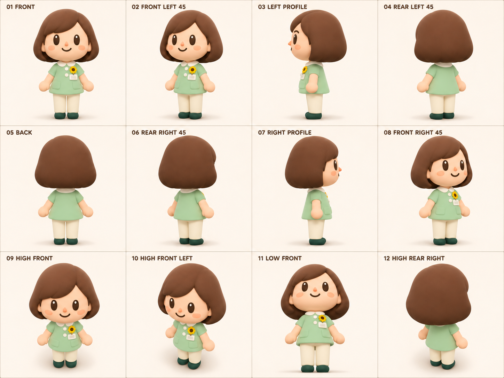

# 민지 12각도 제작 참고

2026-11-23 KST. 사용자가 생성된 12각도 이미지를 Git에 보관하고 Mac Codex에서 제작에 참고하도록 요청했다. 직전 대화 이미지가 작업 폴더에 없어 이를 참조하여 저장용 버전을 다시 생성했다. 이전 단순 민지 시안은 보존한다.

이 이미지는 **생성 참고 이미지**이며 실제 3D 모델의 회전 렌더가 아니다. 02·04 등의 사선은 표기된 45도보다 정면·후면에 가깝고, 귀·앞머리·배지 위치에도 각도 간 오차가 있을 수 있다. 표기 각도를 측정값으로 사용하거나 각 그림에 맞춰 서로 다른 모델을 만들지 않는다. 이미지의 개별 오차보다 하나의 일관된 3D 구조를 우선한다.

- [연결부·표면·배지 제작 및 검수 지시](../../../docs/minji-12-view-modeling-brief.md)
- [파일 해시와 출처](manifest.json)
- [기존 단순 민지 시안](../minji-simple-v1/README.md)

이번 변경은 참고 자료만 추가한다. 기존 모델, 게임 코드, 저장 데이터는 변경하지 않았다.
