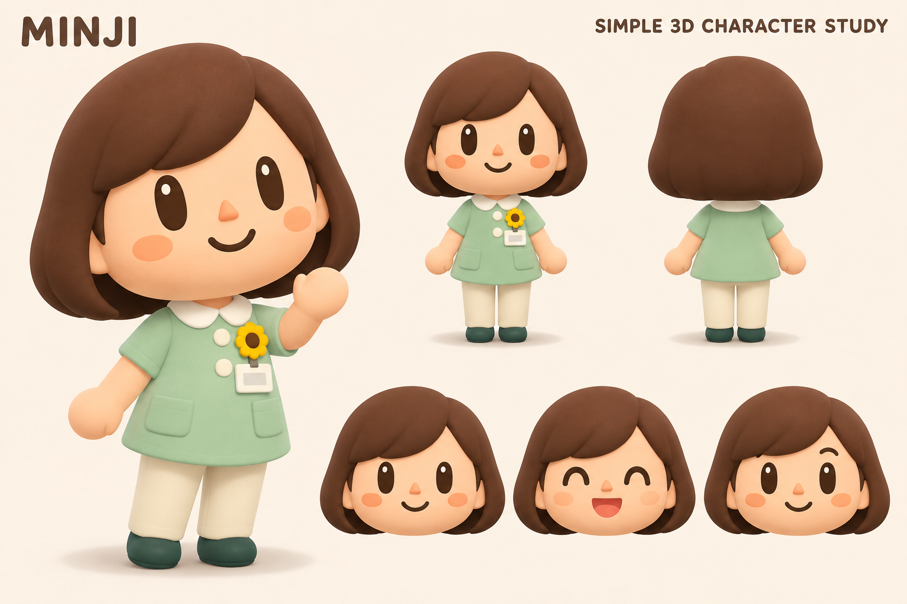

# 민지 · 단순한 3D 캐릭터 제안

2026-11-22 KST: 사용자는 v2·v3 얼굴을 거부하고, 첨부한 동물의 숲 인간 캐릭터처럼 단순한 비율과 표정으로 방향을 변경했다. 갈색 단발·민트 근무복·해바라기 배지는 민지의 식별 요소로 유지한다.

이 PNG는 **생성한 디자인 참고 시안**이다. 실제 Blender 모델, Unity 렌더 또는 최종 사용자 승인 결과가 아니다. 같은 장에 여러 모습을 생성했으므로 엄밀한 정투영 도면도 아니다. 제작 비율은 오른쪽 위 정면을 우선하고, 왼쪽 인사는 분위기·포즈, 후면은 단발 외곽, 아래 얼굴은 표현 방식의 참고로 쓴다.

기존 `../3d-direction-v1/` 이미지는 보존한다. 이번 방향에서는 이전 민지의 사실적인 홍채·입술·머리결·개별 손가락 지시를 적용하지 않는다. 다른 게임의 기존 캐릭터나 에셋을 가져오는 요청이 아니라, 단순한 표현 방식을 참고해 민지의 외형을 제작하는 요청이다.

- [실제 제작 지시](../../../docs/minji-simple-character-direction.md)
- [원본 해시·크기](manifest.json)

이미지의 약한 표면 노이즈는 제작 요구 사항이 아니다. 게임에서는 깨끗한 무광 표면을 사용한다. 게임 규칙·병원 공간·저장 형식을 바꾸지 않는다.
